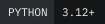
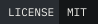

<h1 align="center">
  <picture>
    <source media="(prefers-color-scheme: dark)" srcset="assets/branding/logo-dark.svg">
    <source media="(prefers-color-scheme: light)" srcset="assets/branding/logo-light.svg">
    
  </picture>
</h1>

<p align="center"><strong>Open-source API verification for OpenAPI 3.1.</strong></p>

<p align="center">
  Validate captured JSON responses, run scoped checks against local services,<br>
  and compare evidence across runs to catch regressions.
</p>

<p align="center">
  <a href="#quick-start"></a>
  <a href="https://github.com/Minells/EndNext/actions/workflows/main-ci.yml"></a>
  <a href="LICENSE"></a>
</p>

<p align="center">
  <a href="#quick-start"><strong>Quick start</strong></a> ·
  <a href="#features">Features</a> ·
  <a href="#local-http-checks">Local HTTP checks</a> ·
  <a href="#compare-runs">Compare runs</a> ·
  <a href="#documentation">Docs</a> ·
  <a href="https://github.com/Minells/EndNext/issues">Issues</a>
</p>

> **Pre-release.** Install EndNext from this repository. The examples use synthetic data and run offline or against a bundled loopback service.

## Why EndNext

When an API response breaks its contract, you need to know which operation and field changed and whether the failure is new. EndNext turns a saved response into evidence you can review even after the service shuts down. For local integration testing, it can also collect responses from explicitly selected endpoints.

## How it works

```text
OpenAPI 3.1 contract + saved response         → check → JSON evidence
OpenAPI 3.1 contract + TOML suite              → plan  → cases and request budget
OpenAPI 3.1 contract + authorized local suite → scan  → JSON evidence

Saved evidence              → report → terminal or Markdown
Baseline + current evidence → diff   → regression summary
```

## Quick start

From the repository root on macOS or Linux, create a virtual environment with Python 3.12 or later and install the CLI.

```sh
python3 --version
python3 -m venv .venv
. .venv/bin/activate
python -m pip install .
```

Inspect the sample contract, then validate a passing response and a response with a schema mismatch.

```sh
endnext inspect examples/items.openapi.json
endnext check examples/items.openapi.json examples/item-pass.json
endnext check examples/items.openapi.json examples/item-fail.json
```

The final command exits with code `1` and identifies the failing field.

```text
FAIL GET /items/{id} (getItem) · response.body.schema at /quantity
The schema expects integer. The observed JSON type is string. Observation: imported fixture, HTTP 200.
```

<details>
<summary>Validate your own captured response</summary>

1. Run `endnext inspect contract.yaml` to find the method, exact path template, media type, and security declarations.
2. Copy [the passing fixture](examples/item-pass.json) and set `case`, `method`, and `path_template`. Fill in the scalar values in `path_parameters` when the template has parameters.
3. Set `status` to the observed HTTP status and `media_type` to `application/json`. Set `body` to the captured JSON value and run `endnext check contract.yaml response.json`.

Contracts can be local JSON or JSON-compatible YAML files up to 1 MiB, with references within the same document. Quote numeric YAML keys such as `'200'`. Each invocation of `check` validates one captured response. Reports retain operation, status, provenance, and schema mismatch details while omitting response bodies, parameter values, and raw validator messages. Use shareable case and file names. [Validator notes](docs/VALIDATOR.md)

</details>

## Features

| Command | What it does |
| --- | --- |
| `inspect` | Lists operations, response media types, and contract-level and operation-level security declarations. |
| `check` | Validates a captured response against documented status, media type, and schema. Fixtures can also carry expected status, anonymous access, and cache policy assertions. |
| `plan` | Previews selected operations, effective security, skipped cases, candidate assertions, and estimated request cost entirely offline. |
| `scan` | Runs explicitly configured GET cases against an authorized loopback service, including access checks with named bearer profiles. |
| `report` | Renders saved v1 and v2 JSON evidence as terminal output or Markdown while preserving verdicts, provenance, and counts. |
| `diff` | Compares two evidence files and identifies new failures, resolved failures, and checks that could not be verified. |

Use `--format json` with `inspect`, `check`, `plan`, `scan`, or `diff` to get structured output on stdout.

### Preview a suite offline

```sh
endnext plan examples/items.openapi.json examples/items-plan.toml
```

The sample plan shows one imported fixture, one HTTP case, and one skipped case with a missing fixture. It estimates one request and lists the assertions whose prerequisites must be met during execution.

<details>
<summary>How to define a suite</summary>

Use `select` to choose operations by method and exact path template. Give each `[[cases]]` entry a unique name, an operation, and a source. For `source = "fixture"`, resolve the fixture path relative to the TOML file. For `source = "http"`, specify a GET case with an expected status or access outcome and any scalar path and query parameters. The request budget defaults to zero and accepts values from 0 to 20. The same inputs produce the same plan without network access.

</details>

## Local HTTP checks

On POSIX, `scan` executes the GET cases selected in a TOML suite against a loopback service you are authorized to test. The target requires explicit authorization, a literal loopback IP address, a port, and a path prefix. Use `expected_status` for contract cases. For access cases, choose a named `auth_profile` and set `expected_access` to `"allow"` or `"deny"`. The profile reads its bearer token from the environment at runtime. Plans and reports identify the profile by name.

<details>
<summary>Run the bundled two-identity demo</summary>

The [demo suite](examples/authorization-plan.toml) already defines the loopback target, request budget, and profiles. Start the synthetic service in one terminal from the repository root with the virtual environment active.

```sh
export ENDNEXT_DEMO_ALICE_TOKEN=demo-alice-local
export ENDNEXT_DEMO_BOB_TOKEN=demo-bob-local
python examples/authorization_demo.py
```

In a second terminal, activate the same virtual environment and run the suite.

```sh
export ENDNEXT_DEMO_ALICE_TOKEN=demo-alice-local
export ENDNEXT_DEMO_BOB_TOKEN=demo-bob-local
endnext plan examples/authorization.openapi.json examples/authorization-plan.toml
endnext scan examples/authorization.openapi.json examples/authorization-plan.toml --format json > current.json
endnext report current.json
```

| Case | Expected access | Observed status | Verdict |
| --- | --- | --- | --- |
| Alice reads her own document | Allow | 204 | `PASS` |
| Bob reads Alice's document | Deny | 403 | `PASS` |
| Bob reads his own document | Allow | 403 | `FAIL` |

The scan sends three requests and exits with code `1`. To generate a passing baseline, stop the demo server and restart it with `python examples/authorization_demo.py --healthy`. Run the scan again, writing to `baseline.json`. The healthy run returns HTTP 204 for Bob's own document and exits with code `0`. Run `endnext diff baseline.json current.json` to see the regression.

</details>

<details>
<summary>Read the transport limits and access verdicts</summary>

The transport allows one request per second, up to 20 attempts, with a five-second limit per request, a 60-second acquisition deadline, and up to 1 MiB of retained response body per response. It disables redirects, retries, environment proxies, and cookie propagation, and verifies HTTPS certificates. Reports distinguish request attempts from completed HTTP header sends.

The `security.authenticated_access` rule treats a 2xx response as allowed and a 403 as denied. A 401, ambiguous status, or partially read response yields `INCONCLUSIVE`. An unavailable credential or excluded case yields `SKIPPED`. Malformed tokens, timeouts, and transport failures yield `ERROR`. An access case with any of these three verdicts makes `scan` exit with code `2`. [Security policy](SECURITY.md)

</details>

## Reports and evidence

EndNext records individual assertions so a partial response can still show which checks had enough evidence. Use the policy fixture to see a passing schema check alongside an access mismatch and a cache warning.

```sh
endnext check examples/items.openapi.json examples/item-policy-fail.json --format json > evidence.json
endnext report evidence.json --format markdown
```

The fixture check deliberately exits with code `1` and writes valid JSON evidence. Use `endnext report evidence.json` for the terminal view.

<details>
<summary>Record partial responses and policy expectations</summary>

Set fixture `body_state` to `absent`, `truncated`, or `invalid` and omit `body` when the response lacks a complete JSON value. For HTTP 204, you can omit both body and media type. With `identity: "anonymous"`, the fixture can assert `expected_access` against an imported observation. With `sensitive: true`, `expected_cache_directive` checks for the named directive in `headers.Cache-Control`.

</details>

## Compare runs

Save JSON evidence from two runs of the same suite. In this example, `diff` flags the schema mismatch at `/quantity` as a new failure.

```sh
endnext check examples/items.openapi.json examples/item-pass.json --format json > baseline.json
endnext check examples/items.openapi.json examples/item-fail.json --format json > current.json
endnext diff baseline.json current.json
```

Keep case and profile names stable across runs. Rename a case when its resource or expectation changes, and rename a profile when its identity changes. EndNext matches checks by operation, case name, observation source, rule, and authentication profile where present. The failure fingerprint includes the field location.

Existing failures and warnings remain visible in the summary. A passing assertion confirms a resolution. If a check from the baseline is missing, skipped, or inconclusive in the current run, EndNext reports it as unverified.

| Exit code | `check` / `scan` | `diff` |
| --- | --- | --- |
| `0` | Completed without a failing or blocking incomplete check | Comparable evidence with no new failures or incomplete baseline checks |
| `1` | A failing assertion | At least one new failure |
| `2` | Invalid input, execution error, or a blocking incomplete check | Invalid input, no comparable checks, or incomplete verification |

## Documentation

| Resource | What you’ll find |
| --- | --- |
| [Examples](examples/) | Sample contracts, fixtures, TOML suites, and the local demo service |
| [Validator notes](docs/VALIDATOR.md) | Supported inputs, schema validation decisions, and limitations |
| [Release candidate verification](docs/RELEASE_CANDIDATE.md) | Packaging checks and results from independent projects |
| [Brand guidelines](docs/BRANDING.md) | Official logos, design tokens, and documentation conventions |
| [Security policy](SECURITY.md) | Test scope and private vulnerability reporting |

## Contributing

Follow the [contribution guide](CONTRIBUTING.md) to set up the development environment and run checks. CI verifies linting, types, tests with a 96% combined statement and branch coverage floor, and installation from both wheel and source distribution on Linux and macOS with Python 3.12. Pull requests into `main` require the **EndNext merge gate**.

When a change affects CLI behavior, report formats, or a user workflow, update the relevant README sections, examples, or guides in the same pull request and verify the commands you changed.

## License

EndNext is available under the [MIT License](LICENSE).
