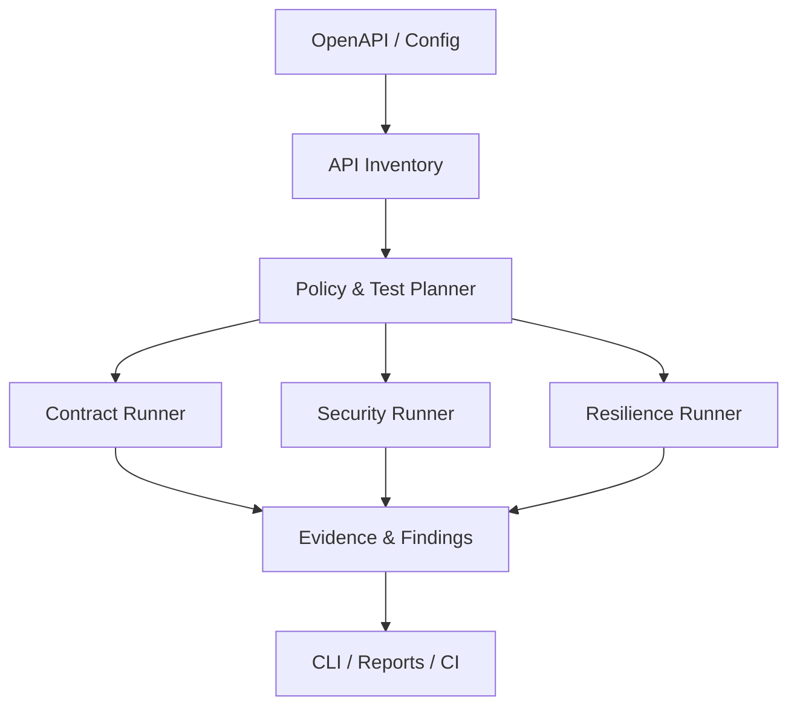

# EndNext — Product Definition & Long-Term Roadmap

> **Nome del prodotto:** **EndNext** (confermato)  
> **Identificativo tecnico proposto:** `endnext` (da verificare su GitHub, PyPI e altri registri)  
> **Stato:** CLI offline, scansione autorizzata, evidenze CI e scenari di resilienza integrati in main
> **Ultimo aggiornamento:** 25 novembre 2026  
> **Promotore:** Luca  
> **Obiettivo personale:** progetto GitHub open source, originale nell'esecuzione, tecnicamente solido e valorizzabile nel portfolio  
> **Disponibilità stimata:** 6–10 ore a settimana

## 1. Executive summary

**EndNext** nasce dall'evoluzione dell'idea iniziale di un *API failure simulator* verso una piattaforma **API Quality & Security Assurance** per sviluppatori e proprietari di servizi.

L'obiettivo è offrire uno strumento **local-first, CLI-first e integrabile in CI/CD** che, partendo dal contratto di un'API REST, costruisca un inventario delle operazioni e verifichi progressivamente:

1. **Conformità al contratto:** richieste, risposte e codici di stato coerenti con OpenAPI.
2. **Robustezza:** gestione di input invalidi, errori imprevisti e — nelle versioni successive — indisponibilità delle dipendenze.
3. **Sicurezza applicativa:** controlli non invasivi su autenticazione, configurazione e leakage di informazioni; successivamente autorizzazioni multiutente e test dinamici avanzati.

Il valore principale non sarà il numero di payload o vulnerabilità dichiarati, ma **la produzione di risultati spiegabili e riproducibili per ciascun endpoint**, compresa l'indicazione precisa di cosa non è stato testato.

### Proposta di valore (formulazione di lavoro)

> Test your APIs against their contracts, failure scenarios, and security requirements — locally, repeatably, and with evidence you can trust.

**Nota strategica:** la categoria esiste già. Il progetto non deve presentarsi come un sostituto universale di OWASP ZAP, Schemathesis, Akto o 42Crunch. Dovrà trovare una differenziazione nell'esperienza dello sviluppatore, nell'unificazione dei risultati e nella verificabilità delle evidenze.

## 2. Registro delle decisioni

### 2.1 Elementi confermati nella discussione

| Decisione | Stato |
| --- | --- |
| Creare un nuovo progetto GitHub distinto da SOVRAN | Confermato |
| Orientarlo a esigenze concrete di chi sviluppa software e API, anche in ambito AI | Confermato |
| Dare priorità alla qualità tecnica e al valore per il portfolio, non alla monetizzazione | Confermato come priorità; modello economico non deciso |
| Dedicarvi circa 6–10 ore settimanali | Confermato |
| Evolvere l'idea di fault injection verso contract, robustness e security testing delle API | Confermato come direzione di prodotto |
| Prevedere release incrementali e una roadmap di lungo periodo | Confermato |
| Adottare **EndNext** come nome ufficiale del prodotto | **Confermato il 25 novembre 2026** |

### 2.2 Raccomandazioni progettuali ancora da ratificare

| Tema | Direzione proposta | Stato |
| --- | --- | --- |
| Target iniziale | Backend developer e piccoli team DevSecOps proprietari delle API | Proposta |
| Protocollo iniziale | REST/HTTP con OpenAPI 3.0/3.1 | Proposta |
| Esperienza | CLI-first, local-first, nessun account obbligatorio | Proposta |
| Linguaggio del core | Python | Proposta |
| Distribuzione | PyPI / `uvx` | Proposta |
| Licenza | MIT, dopo verifica delle dipendenze e degli asset | Proposta |
| Interfaccia grafica | Non nel primo MVP | Proposta |
| Modello AI | Non necessario per generare verdetti di sicurezza | Proposta |

**Regola:** una raccomandazione non ancora approvata non deve essere trattata come requisito irrevocabile in prompt di implementazione o issue di sviluppo.

## 3. Problema e utenti

### 3.1 Problema

Un servizio può avere test unitari verdi e un contratto OpenAPI valido, pur presentando:

- Risposte incompatibili con gli schemi documentati.
- Errori `5xx` causati da input non validi.
- Requisiti di autenticazione non applicati correttamente.
- Risposte che espongono dettagli interni o dati sensibili.
- Comportamenti non previsti in caso di timeout o dipendenze indisponibili.
- Scarsa visibilità sui test effettivamente eseguiti nelle pipeline.

Oggi questi problemi vengono affrontati con più categorie di strumenti: contract testing, property-based testing, DAST, tool di fault injection e suite CI. L'ipotesi da validare è che esista un vantaggio concreto nel riunire i loro risultati in un flusso orientato al singolo endpoint.

### 3.2 Personas iniziali

1. **Backend developer:** desidera controllare un servizio FastAPI, Spring Boot o equivalente prima di una release.
2. **Maintainer open source:** vuole uno strumento riproducibile, senza obbligo di account esterni, che possa girare in GitHub Actions.
3. **DevSecOps / QA engineer di piccolo team:** vuole distinguere vulnerabilità confermate, possibili rischi e lacune della copertura.

### 3.3 Jobs to be done

- "Ho un file OpenAPI e voglio sapere quali operazioni riesco realmente a verificare."
- "Voglio individuare regressioni di schema e gestione errori prima di pubblicare il backend."
- "Voglio controllare che un endpoint dichiarato protetto rifiuti richieste senza credenziali o con credenziali non valide."
- "Voglio condividere una prova riproducibile di un problema, non solo un punteggio di rischio."
- "Voglio confrontare due release e riconoscere problemi nuovi, preesistenti o non verificabili."

## 4. Principi di prodotto

1. **Evidence-first.** Ogni finding deve mostrare richiesta, risposta, regola applicata e motivazione del verdetto; i dati sensibili vanno oscurati.
2. **No false assurance.** `SKIPPED`, `INCONCLUSIVE` ed errori dell'infrastruttura non equivalgono a `PASS`.
3. **Safe by default.** Il prodotto non esegue automaticamente scan attivi su host non esplicitamente autorizzati e non considera innocui gli endpoint solo in base al metodo HTTP.
4. **Local-first.** Il flusso principale non richiede un servizio cloud proprietario.
5. **Extensible, not monolithic.** Parser, planner, runner, policy e reporter sono moduli separati.
6. **Deterministic where possible.** Test generati con seed, configurazione versionata, limiti di rete e criteri di confronto riproducibili.
7. **Standards-based.** OpenAPI e riferimenti OWASP guidano i controlli; il prodotto non dichiara certificazioni o conformità complessive non dimostrate.
8. **Developer experience.** Installazione semplice, output chiaro, configurazione essenziale, esempi che funzionano subito.

## 5. Perimetro funzionale

### 5.1 Contract & functional testing

Controlli candidati:

- Tipi di dati e campi richiesti.
- Limiti, enum, pattern e vincoli dichiarati.
- JSON malformato, dove il comportamento atteso è definibile.
- Codici HTTP ammessi dalla specifica.
- Conformità delle risposte agli schemi.
- Metodi HTTP non documentati, nei limiti consentiti dalla policy.
- Errori `5xx` inattesi su input controllati.

**Nota:** gli status attesi per input non validi non vanno hardcodati universalmente (ad esempio `400` vs `422`); il verdetto deve tener conto del contratto e della policy.

### 5.2 Security baseline

Controlli iniziali candidati, da classificare per affidabilità e precondizioni:

- Requisiti di autenticazione dichiarati, ma non applicati su risposte osservate.
- Credenziali mancanti o volutamente non valide, senza credential guessing.
- Header e configurazioni rilevanti nel contesto (CORS, caching di risposte sensibili, informazioni di implementazione).
- Stack trace, debug messages e dettagli infrastrutturali nelle risposte.
- Potenziali esposizioni di informazioni sensibili, segnalate come ipotesi se manca il contesto necessario.

L'assenza di un header non è automaticamente una vulnerabilità critica. Un `200 OK` senza token non prova da solo un authentication bypass se l'endpoint è intenzionalmente pubblico.

### 5.3 Authorization testing (fase successiva)

- Profili distinti per utente A e utente B.
- Risorse di test con proprietà nota.
- Confronto delle richieste sulla medesima risorsa con identità differenti (BOLA/IDOR).
- Test di privilegi verticali solo quando l'utente fornisce ruoli e aspettative.
- Richieste mutative solo in ambienti e dataset esplicitamente predisposti.

### 5.4 Resilience & fault injection (fase successiva)

Distinguere **test black-box** da **guasti introdotti nelle dipendenze**:

- Black-box: input anomali, errori HTTP osservati, timeout del client e robustezza delle risposte.
- Fault injection: proxy o adapter tra servizio e dipendenze per introdurre latenza, `429`, `503`, interruzioni e risposte sequenziali controllate.
- Assert su numero di tentativi, retry, recovery e comportamenti attesi.

Uno scanner che vede soltanto le API esposte non può rendere indisponibile PostgreSQL o un servizio downstream senza accesso controllato all'ambiente o alla rete del servizio.

### 5.5 Cosa non promettere

- Rilevare **tutte** le vulnerabilità o **tutte** le backdoor.
- Certificare l'assenza di bug o vulnerabilità dopo una scansione verde.
- Scoprire ogni endpoint nascosto partendo da un OpenAPI incompleto.
- Determinare automaticamente tutte le regole di business e autorizzazione senza dati di contesto.
- Effettuare scansioni invasive in produzione senza rischio di effetti collaterali.

## 6. Modello di scansione e reporting

### 6.1 Flusso previsto



### 6.2 Stati dei risultati

| Stato | Significato |
| --- | --- |
| `PASS` | L'assert specificato è stato verificato nell'esecuzione corrente. |
| `FAIL` | Il comportamento osservato contraddice l'assert, con evidenza sufficiente. |
| `WARN` | Indicatore di rischio o buona pratica non rispettata, senza prova completa di vulnerabilità. |
| `INCONCLUSIVE` | Il test è stato tentato, ma non permette una conclusione affidabile. |
| `SKIPPED` | Test applicabile ma non eseguito, con motivazione (policy, credenziali, fixture). |
| `ERROR` | Il runner o l'ambiente di test non hanno funzionato correttamente. |

In seguito i finding potranno includere severità, confidenza, categoria OWASP, fingerprint e stato rispetto alla baseline precedente. Le metriche di copertura dovranno riferirsi ai **controlli candidati e realmente eseguiti**, non a una percentuale indefinita di vulnerabilità possibili.

### 6.3 Evidenze minime per finding

- Identificatore di scansione e versione del motore.
- Endpoint, metodo e identificatore dell'operazione OpenAPI.
- Controllo e precondizioni.
- Input sanitizzato, output sanitizzato e status osservato.
- Aspettativa, verdetto e spiegazione.
- Indicazione se il comportamento è riproducibile e istruzioni per il replay.
- Tempo di esecuzione e, ove utile, seed/versione del contratto.

### 6.4 Formati

- **V0.1:** terminale, JSON e Markdown.
- **V0.2:** baseline/diff e output utilizzabili in GitHub Actions.
- **Successivo:** SARIF, HTML interattivo e dashboard locale, se richiesti dagli utenti.

## 7. Architettura tecnica proposta

### 7.1 Stack iniziale (non ancora ratificato)

| Ambito | Scelta proposta | Motivazione |
| --- | --- | --- |
| Linguaggio | Python | Esperienza del promotore e maturità dell'ecosistema HTTP/API testing. |
| CLI | Typer | Interfaccia developer-friendly. |
| Trasporto HTTP | HTTPX | Client per richieste controllate e asincrone. |
| OpenAPI/JSON Schema | Librerie di validazione appropriate | Evitare parser spec custom fragili. |
| Property-based / contract tests | Schemathesis, se coerente con i vincoli | Riutilizzare test già maturi. |
| Test del prodotto | pytest | Unit, integration e test end-to-end. |
| Config | YAML | Facilità di versionamento. |
| Distribuzione | PyPI / `uvx` | Un comando, nessun servizio obbligatorio. |

Tutte le versioni e le licenze delle dipendenze dovranno essere verificate al momento dell'implementazione. OWASP ZAP e altri scanner possono diventare **adapter opzionali**; non sono prerequisiti del primo MVP.

### 7.2 Moduli logici

```text
core/
  inventory/       # parser e normalizzazione delle operazioni
  planner/         # scelta controlli e loro precondizioni
  policies/        # scope, rate, metodi e profili di esecuzione
  evidence/        # modello tipizzato dei risultati
engines/
  contract/        # conformità e input negativi
  security/        # baseline e test autenticazione
  resilience/      # scenari controllati; inizialmente minimale
adapters/
  openapi/         # import contratto
  http/            # trasporto e autenticazione
  external/        # integrazioni opzionali future
reporters/
  terminal/
  json/
  markdown/
cli/
tests/
examples/
docs/
```

Questa struttura è un **modello concettuale**, non un vincolo sull'organizzazione esatta dei package.

### 7.3 Separazione delle responsabilità

- **Inventory:** descrive le API conosciute; non inventa endpoint non documentati.
- **Planner:** decide quali test possono essere eseguiti e quali dati servono.
- **Policy:** impone vincoli prima che una richiesta venga inviata.
- **Runner:** esegue solo test consentiti, senza attribuire severità arbitrarie.
- **Evidence model:** normalizza risultati da runner interni e futuri adapter esterni.
- **Reporter:** presenta i risultati senza cambiarne la semantica.

## 8. Sicurezza e limiti operativi dello scanner

È una priorità di prodotto, non un'attività opzionale da rimandare.

1. Gli scan attivi devono essere eseguiti **solo verso sistemi di proprietà o esplicitamente autorizzati**.
2. La CLI deve poter fare `inspect` e `plan` senza traffico di rete.
3. L'esecuzione richiede target e scope espliciti; prevedere allowlist di host, porte e redirect.
4. I test potenzialmente invasivi devono essere disabilitati nel profilo `safe` e richiedere opt-in specifico.
5. Rate limit, concurrency limit, timeout e budget massimo di richieste devono essere configurabili.
6. Per i test che modificano dati, raccomandare staging e fixture sacrificabili, con cleanup quando possibile.
7. Token, cookie, URL con credenziali, payload sensibili e dati personali non devono finire nei report in chiaro.
8. Non effettuare credential stuffing, brute force o test distruttivi come comportamento predefinito.
9. Non eseguire codice arbitrario contenuto in OpenAPI, HAR o file di configurazione non affidabili.
10. Gestire in modo rigoroso target e redirect per ridurre il rischio di richieste verso indirizzi fuori scope.
11. Prevedere `SECURITY.md`, responsible disclosure e avvertenze chiare su falsi positivi/negativi.

Un risultato senza finding non potrà mai essere comunicato come certificazione di sicurezza del servizio.

## 9. Competitor e posizionamento

| Strumento | Area principale | Posizionamento rispetto al progetto |
| --- | --- | --- |
| OWASP ZAP | DAST, import OpenAPI e scan attivi/passivi | Motore di security testing molto più ampio; possibile adapter futuro. |
| Schemathesis | Contract, property-based e stateful API testing | Possibile componente riutilizzabile; già include controlli di auth e alcune verifiche BOLA. |
| Akto | API discovery, testing e monitoraggio | Competitor di piattaforma con inventario e workflow di sicurezza. |
| RESTler (Microsoft) | Stateful fuzzing REST | Riferimento per test sequenziali avanzati, non da replicare nel MVP. |
| 42Crunch | Audit OpenAPI e runtime scanning commerciale | Dimostra che contract + security è una categoria già presidiata. |
| StackHawk | DAST developer-centric e scansioni autenticate | Competitor commerciale su esperienza developer e CI/CD. |
| Nuclei | Vulnerability scanning basato su template | Ecosistema già esteso: non replicare una libreria generica di payload. |
| OWASP API Security Testing Framework | Test di vulnerabilità API | Progetto open source in evoluzione da monitorare. |

### Ipotesi di differenziazione da validare

- **Un solo report per endpoint** con contract, reliability e security.
- **Evidence-first** e visibilità delle verifiche non eseguite o inconcludenti.
- **Workflow locale** senza registrazioni cloud obbligatorie.
- **Regression gate** ripetibile su GitHub Actions.
- **Fault injection applicativa** come evoluzione naturale, separata dal DAST.

La presenza di questi elementi non prova da sola un vantaggio competitivo. Serviranno confronti pratici con le alternative e feedback di utenti esterni.

### Riferimenti

- [OWASP API Security Top 10](https://owasp.org/projects/api-security-project)
- [OWASP REST Assessment Cheat Sheet](https://cheatsheetseries.owasp.org/cheatsheets/REST_Assessment_Cheat_Sheet.html)
- [OWASP ZAP API Scan](https://www.zaproxy.org/docs/docker/api-scan/)
- [Schemathesis](https://github.com/schemathesis/schemathesis)
- [Akto](https://github.com/akto-api-security/akto)
- [Microsoft RESTler](https://github.com/microsoft/restler-fuzzer)
- [42Crunch](https://42crunch.com/api-security-testing.html)
- [StackHawk](https://docs.stackhawk.com/getting-started/)
- [OWASP API Security Testing Framework](https://owasp.org/www-project-api-security-testing-framework/)

## 10. Roadmap di sviluppo

La [roadmap corrente](ROADMAP.md) definisce le prossime milestone e le relative prove. Le fasi seguenti documentano la pianificazione iniziale.

**Pianificazione indicativa** per 6–10 ore/settimana. Le date sono ipotesi di lavoro: ogni fase successiva dipende da qualità, feedback e risorse disponibili.

### Fase 0 — Product foundation (circa 2 settimane)

**Deliverable:** architettura documentata, repository pronto, fixture di test e schema delle evidenze.

Attività:

- Definire personas, scenari e requisiti funzionali/non funzionali.
- Selezionare stack e librerie dopo proof of concept.
- Creare una demo API locale controllata, con comportamenti corretti e difetti intenzionali.
- Definire il modello dei test, gli stati dei risultati e gli schemi JSON.
- Progettare policy e vincoli dello scanner.
- Configurare lint, type check, unit test, CI, licenza candidata, CONTRIBUTING, SECURITY e issue templates.

**Criterio di uscita:** un documento di architettura e almeno due scenari end-to-end riproducibili sulla demo, anche con runner provvisori.

### V0.1 — Contract & Security Baseline (8–12 settimane di lavoro successive)

**Obiettivo:** prima release pubblica che possa essere usata su una API REST di staging.

**Incluso:**

- OpenAPI 3.0/3.1 JSON/YAML da file e URL.
- Inventory endpoint e operation ID.
- Piano dei test e motivazioni degli skip.
- Test positivi/negativi di tipo e validazione.
- Verifica di status code, schema delle risposte ed errori `5xx` inattesi.
- Baseline non invasiva di autenticazione e configurazioni di sicurezza.
- CLI con `inspect`, `plan`, `scan`, `report` (nomi provvisori).
- Formati terminale, JSON e Markdown.
- Configurazione di target/scope, rate e timeout.
- Esempi, documentazione, suite automatizzata e release PyPI.

**Esplicitamente escluso:** BOLA multiutente generalizzato, fuzzing offensivo approfondito, attacchi distruttivi, auto-fix, dashboard web, integrazioni cloud obbligatorie, analisi con LLM.

**Criteri di uscita proposti:**

- Demo locale che mostra PASS, FAIL, WARN, SKIPPED e INCONCLUSIVE.
- Ogni finding FAIL riproducibile sui casi dimostrativi.
- Almeno tre prove su repository o servizi non sviluppati appositamente per il prodotto.
- Nessuna credenziale presente in chiaro nei report dei test di sicurezza.
- Documentazione di installazione provata su almeno macOS e Linux.
- Limitazioni documentate, senza rivendicare una scansione di sicurezza completa.

### V0.2 — Identity, Authorization & CI (circa 2–3 mesi aggiuntivi)

**Obiettivo:** introdurre verifiche contestuali e uso ricorrente nelle pipeline.

- Profili auth con token e credenziali fornite tramite environment o secret store, non committate nel repository.
- Due identità e risorse di test note per verifiche BOLA/IDOR controllate.
- Regole per permessi di operazione e ruoli, con aspettative dichiarate dal proprietario.
- Baseline e confronto fra scansioni.
- GitHub Actions, policy di exit code e artefatti dei report.
- Fingerprint dei finding per distinguere regressioni da problemi preesistenti.
- Opzioni di suppression con motivazione e scadenza.

**Criterio di uscita:** un caso multiutente riproducibile rileva un problema reale nel servizio demo e una GitHub Action segnala una nuova regressione senza considerare PASS i test non eseguiti.

### V0.3 — Resilience & Fault Injection (circa 3–4 mesi aggiuntivi)

**Obiettivo:** recuperare ed evolvere l'idea originale del fault simulator.

- Motore separato per scenari di guasto deterministici.
- Proxy controllato verso dipendenze di prova.
- Simulazione di latenza, risposte sequenziali `429`/`503`, timeout e interruzioni.
- Assert su retry, limite tentativi, tempo di recupero e outcome finale.
- Seed, replay, log degli eventi e correlazione con i finding della scansione.
- Test applicabili inizialmente a HTTP/1.1; supporto streaming e protocolli ulteriori solo dopo verifica tecnica.

**Criterio di uscita:** una demo con un client funzionante e uno difettoso mostra, a parità di scenario, un PASS e un FAIL supportati da evidenze.

### V1.0 — Stable Developer Platform (orizzonte complessivo 12–18 mesi)

**Obiettivo:** stabilizzazione, API interne versionate e adozione da parte di utenti esterni.

- Policy engine e API per plugin documentate.
- Miglioramento dell'accuratezza e benchmark ripetibili contro demo vulnerabili e dataset controllati.
- Adapter opzionali verso scanner esistenti, dopo verifica licenze e sicurezza.
- Import Postman/HAR se giustificato dalla domanda.
- Report SARIF/HTML, se richiesti dai team.
- Gestione più robusta di configurazioni e autenticazioni complesse.
- Stabilità su macOS, Linux e valutazione del supporto Windows.
- SemVer, changelog, guida di migrazione e processo di security disclosure.
- Ottimizzazioni sulle prestazioni per servizi con molte operazioni.

**Criterio di uscita:** documentazione affidabile, regressioni monitorate, compatibilità confermata e utenti esterni che eseguono il prodotto senza assistenza diretta.

Le verifiche tecniche sono descritte nella [guida di migrazione](MIGRATING.md),
nella [documentazione dell'API Python](PYTHON_API.md) e nel [benchmark](BENCHMARK.md).
L'adozione autonoma da parte di utenti indipendenti richiede riscontri esterni.

### Oltre V1.0 — Direzioni di lungo periodo (18–36 mesi, condizionali)

Il backlog strategico include:

- Discovery da traffico reale, gateway o sorgenti applicativi per confrontare API documentate ed esposte.
- Supporto GraphQL, gRPC e protocolli emergenti.
- Integrazioni con OpenTelemetry, Kubernetes e API gateway.
- Motori di test specifici per LLM API, tool endpoint e MCP.
- Dashboard locale per esplorare storico, copertura ed evidenze.
- Plugin community e catalogo di regole versionate.
- Analisi assistita da AI per classificazione e spiegazione dei finding, **senza demandarle il verdetto di sicurezza**.
- Eventuali workflow per team e sistemi distribuiti solo se richiesti dalla comunità.

**Regola di priorità:** non implementare automaticamente queste idee. Valutare domanda, contributori e costi di manutenzione prima di aggiungere piattaforme o protocolli.

## 11. Piano di qualità e validazione

### 11.1 Test del prodotto

- Unit test per parser, planner, policy, matcher e modello delle evidenze.
- Integration test verso un server HTTP locale con fixture deterministiche.
- Test di parsing di specifiche incomplete, malformate e con riferimenti.
- Test con proxy, redirect, timeout, TLS e errori di rete.
- Test di sanitizzazione dei log e dei report.
- Regression test per i falsi positivi già incontrati.
- Test di compatibilità su piattaforme supportate.

### 11.2 Dataset e demo

Prevedere una demo locale con:

- Endpoint conformi.
- Endpoint che restituiscono un `5xx` su input invalidi.
- Risposte che violano lo schema.
- Route intenzionalmente protette e route pubbliche.
- Un caso controllato di informazione sensibile esposta.
- Successivamente un caso BOLA con due utenti e risorse distinte.
- Successivamente una dipendenza con fallimenti programmati.

OWASP crAPI e VAmPI possono essere valutati come ambienti supplementari di test, eseguiti localmente e con le autorizzazioni necessarie.

### 11.3 Metriche da osservare

- Tempo dal primo comando al primo report valido.
- Percentuale di operazioni inventariate rispetto alla specifica fornita.
- Numero di controlli candidati, eseguiti, skipped e inconcludenti.
- Falsi positivi e falsi negativi su suite con ground truth.
- Riproducibilità dei finding.
- Tempo e numero di richieste per scansione.
- Numero di utilizzatori esterni e riutilizzo in CI.

Non usare le stelle GitHub come unica metrica di successo.

## 12. Go-to-market open source

### 12.1 Prima esposizione pubblica

- Repository pubblico GitHub dopo raggiungimento della V0.1 utilizzabile.
- README con problem statement, quickstart, esempio prima/dopo e limitazioni.
- Demo breve (GIF/video) che mostra un difetto rilevato e la sua correzione.
- Pacchetto installabile e release versionate.
- CONTRIBUTING, CODE_OF_CONDUCT, SECURITY, issue templates e roadmap.
- Esempi riproducibili senza account terzi.

### 12.2 Prime persone a coinvolgere

- 3–5 sviluppatori backend esterni alla realizzazione della demo.
- Un maintainer di API open source.
- Almeno una persona con esperienza in application security.

### 12.3 Ipotesi da verificare prima di investire nelle fasi successive

1. I risultati integrati sono più utili delle singole uscite di Schemathesis e ZAP?
2. Il planner risparmia configurazione rispetto agli strumenti esistenti?
3. La visibilità `SKIPPED`/`INCONCLUSIVE` aumenta davvero la fiducia nel report?
4. I team desiderano usare lo strumento in CI o solo durante lo sviluppo locale?
5. Quali 3 categorie di controlli producono più valore concreto?

## 13. Rischi principali e mitigazioni

| Rischio | Impatto | Mitigazione |
| --- | --- | --- |
| Scope eccessivo: tentare di replicare ZAP e piattaforme DAST mature | Molto alto | V0.1 ristretta, riuso di librerie affidabili, roadmap condizionale. |
| Falsi positivi di security | Molto alto | Evidence model, precondizioni, `INCONCLUSIVE`, benchmark di test. |
| Effetti collaterali degli scan attivi | Molto alto | Scope, rate limit, profili sicuri, staging e opt-in esplicito. |
| Credenziali nei log | Alto | Redazione automatica, test di sanitizzazione, policy di retention. |
| Contratti OpenAPI incompleti | Alto | Inventory trasparente, impossibilità di certificare endpoint non osservati. |
| Autorizzazioni e business logic non inferibili dal contratto | Alto | Identità multiple e aspettative fornite dall'utente. |
| Dipendenza da scanner esterni e licenze incompatibili | Medio-alto | Adapter opzionali e verifica delle condizioni di distribuzione. |
| Manutenzione con poche ore disponibili | Alto | Release piccole, qualità prima delle funzionalità, supporto piattaforme limitato all'inizio. |
| Concorrenza già matura | Alto | Focus su developer experience, evidenze, regressioni e resilienza controllata. |

## 14. Naming, marchi e identità visiva

### Stato: EndNext — NOME CONFERMATO

Il nome ufficiale del progetto è **EndNext**, scelto da Luca il **25 novembre 2026**. L'idea di naming iniziale **FaultLane** e le altre alternative sono state scartate. Nei documenti pubblici, nel README e nella comunicazione usare **EndNext** come brand; la grafia tecnica candidata per CLI, repository e package è `endnext`, subordinata alla disponibilità dei rispettivi identificativi.

**Posizionamento descrittivo:** *API Quality, Reliability & Security Assurance*. Questa descrizione identifica la categoria del prodotto e non costituisce una promessa di sicurezza esaustiva.

**Tagline di lavoro (non ancora approvata):** *Know what your APIs really do.*

### Verifiche sul nome e attività residue

Il promotore riferisce di aver cercato **EndNext** in [TMview](https://www.tmdn.org/tmview/advancedSearch.html) senza trovare una corrispondenza esatta. Si tratta di una **verifica preliminare effettuata dall'utente**, non di una clearance legale definitiva o di un'attestazione che non esistano marchi simili.

Prima della pubblicazione e dell'eventuale investimento nel marchio:

1. Controllare varianti e similitudini fonetiche/visive su TMview, con attenzione alle classi 9 e 42 e alle attività pertinenti.
2. Incrociare i risultati con [EUIPO](https://www.euipo.europa.eu/en/search-ip) e [WIPO Global Brand Database](https://branddb.wipo.int/), considerando territori e servizi effettivi.
3. Verificare repository/organizzazioni GitHub, nome pacchetto PyPI, altri package registry e domini desiderati.
4. Evitare loghi, naming secondari e descrizioni confondibili con strumenti o aziende già esistenti.
5. Considerare una valutazione professionale del rischio di confondibilità prima di investimenti sostanziali nel brand.

L'identità visiva non blocca la V0.1: prima stabilizzare funzionalità, CLI e affidabilità dei risultati.

## 15. Backlog prioritarizzato

### P0 — Indispensabile per V0.1

- [ ] Ratificare linguaggio, distribuzione e licenza.
- [ ] Definire schema JSON di test, evidenza e finding.
- [ ] Implementare parser/inventory OpenAPI.
- [ ] Implementare planner e policy engine.
- [ ] Implementare runner contract base e controlli di error handling.
- [ ] Implementare baseline security non invasiva.
- [ ] Implementare sanitizzazione dati sensibili.
- [ ] Implementare report terminale/JSON/Markdown.
- [ ] Implementare demo locale e test end-to-end.
- [ ] Documentare limiti, permessi e modalità sicure.
- [ ] Pubblicare release e quickstart.

### P1 — Dopo la prima release

- [ ] Feedback di utenti esterni e triage dei falsi positivi.
- [ ] Autenticazioni configurabili e refresh token, secondo necessità.
- [ ] Test multiutente con fixture esplicite.
- [ ] Baseline e regressioni CI.
- [ ] GitHub Action e policy di gating.

### P2 — Differenziazione tecnica

- [ ] Fault injection engine indipendente.
- [ ] Retry/recovery assertions.
- [ ] Adapter esterni opzionali.
- [ ] Report SARIF/HTML.

### P3 — Valutare solo con domanda dimostrata

- [ ] Dashboard web locale.
- [ ] GraphQL/gRPC.
- [ ] Runtime traffic discovery.
- [ ] Kubernetes/OpenTelemetry.
- [ ] AI endpoint e MCP testing.
- [ ] Workflow di collaborazione.

## 16. Prossime decisioni aperte

1. **Stack:** confermare Python rispetto a TypeScript o ad altre alternative.
2. **Motore V0.1:** scegliere se riutilizzare Schemathesis direttamente, tramite adapter, o solo per alcuni test.
3. **Security baseline:** definire il catalogo preciso di controlli, precondizioni e criteri per `FAIL`/`WARN`.
4. **Modalità di scansione:** finalizzare la policy di scope, opt-in e limitazioni per endpoint mutativi.
5. **Distribuzione e naming tecnico:** verificare versioni/licenze delle dipendenze, packaging multipiattaforma, disponibilità di `endnext` su GitHub/PyPI e marchi simili.
6. **Success criteria:** concordare quali prove con utenti esterni abilitano V0.2.

---

## 17. Sintesi finale

**EndNext** è **un developer-first API assurance tool**, non una promessa di penetration testing esaustivo. La V0.1 dovrà fornire risultati verificabili su API REST documentate, con contract testing, error handling e una baseline di sicurezza prudente. Le successive versioni aggiungeranno identità e autorizzazioni, CI e regressioni, poi fault injection e scansioni più avanzate.

Il progetto è pensato come prodotto open source indipendente da SOVRAN, utilizzabile da uno sviluppatore senza account o infrastrutture proprietarie obbligatorie. La qualità dei risultati, la sicurezza dell'esecuzione e l'esperienza utente prevalgono sulla quantità di controlli dichiarati.

**Nome ufficiale: EndNext.** Stack e dettagli tecnici restano soggetti a valutazione prima dell'implementazione.
